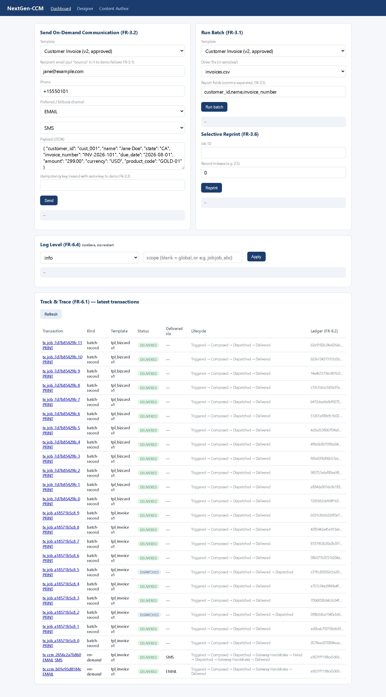
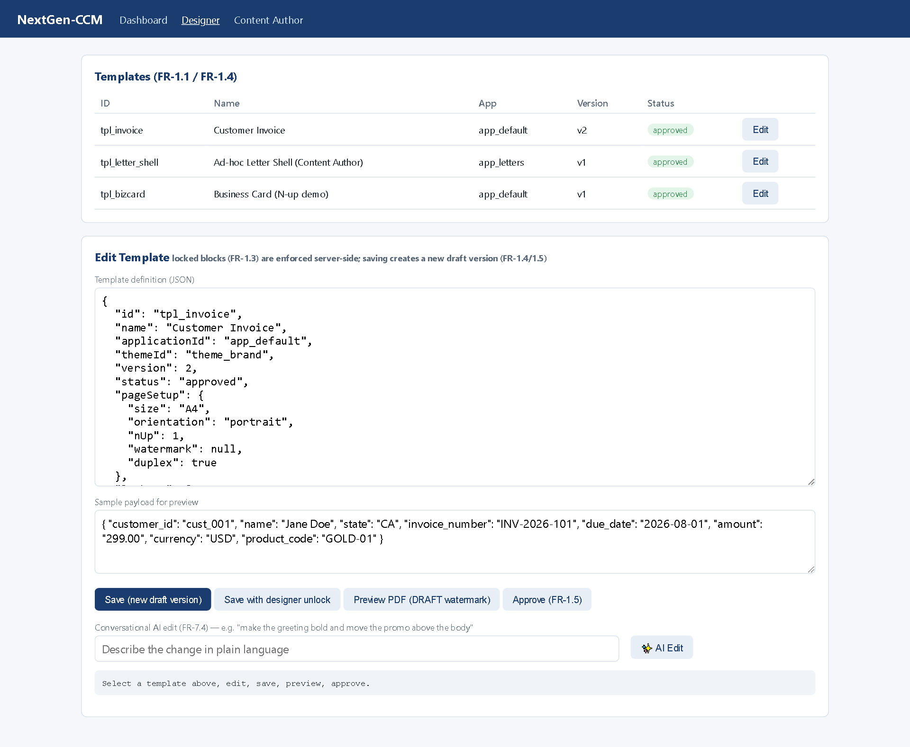
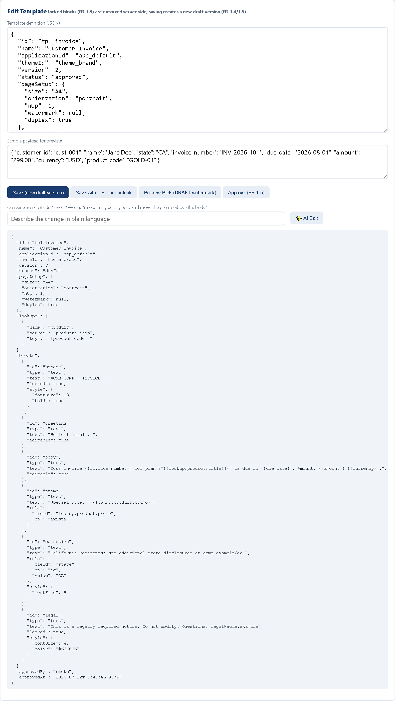
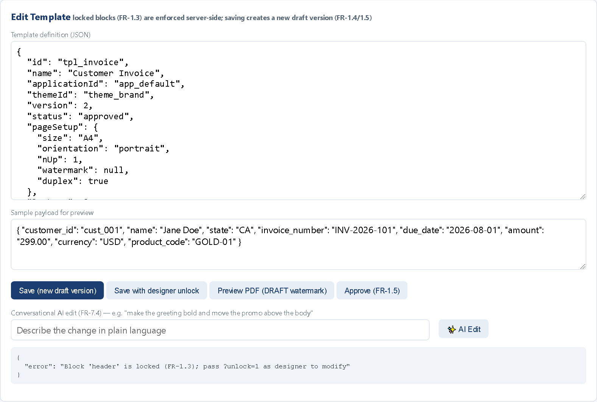
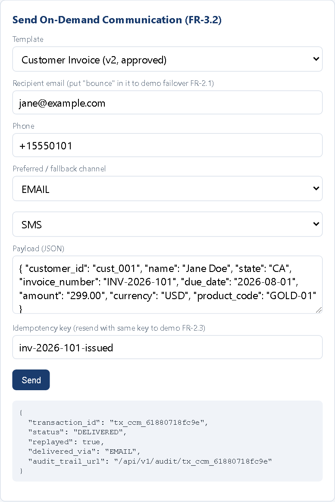
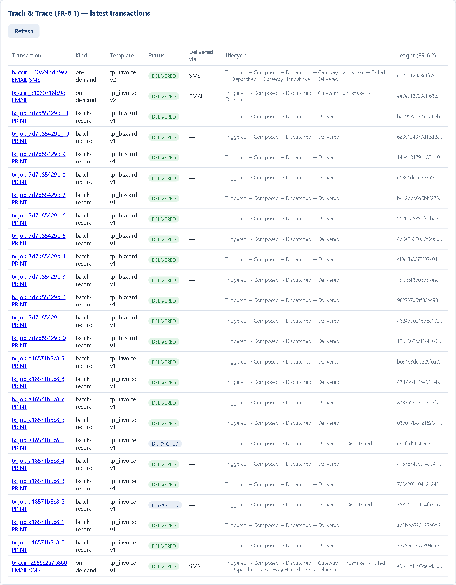
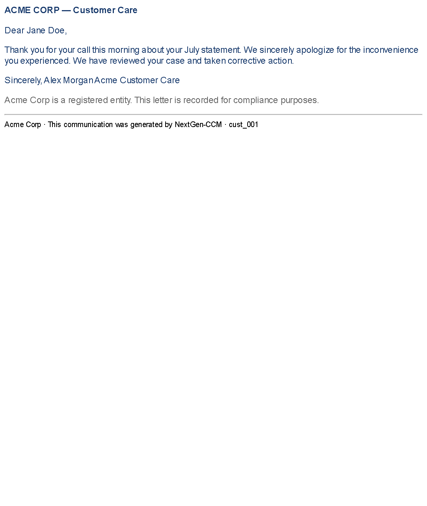
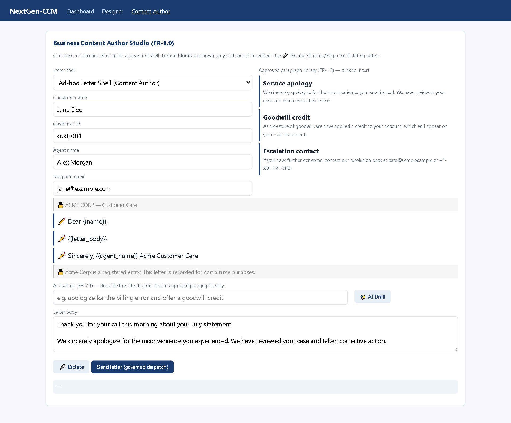

# NextGen-CCM Persona Training Tutorial

**Basis:** PRD v1.3.0 (`PRD.md`) · training modules 01–15 · `status.md` (implementation truth)
**Hands-on system:** Node.js reference MVP — backend on :3000, frontend on :8080
**Screenshots:** captured live from the running MVP on 2026-07-12, after a clean 23/23 smoke run. JSON excerpts are unedited API responses and generated files from the same session (long hashes abridged with `…`).

A hands-on tutorial for every NextGen-CCM persona. Each track walks a complete scenario catalog for that seat and ends with a knowledge check. Every capability is keyed to its FR code in `PRD.md` — **if there is no FR, it is not a committed capability.**

An HTML edition of this tutorial (same content, richer figures, screenshots embedded — no `images/` dependency) is available at [`tutorial.html`](tutorial.html); open it directly in any browser. This markdown edition is the diff-friendly source of record.

---

## Scenario catalog

| # | Scenario | Track | FR codes |
|---|---|---|---|
| A1 | Tour the Web Designer and read a template definition | Designer | FR-1.1, FR-1.2 |
| A2 | Edit a block; version auto-bumps to a draft | Designer | FR-1.4 |
| A3 | Try to change a locked block → server rejects (403) | Designer | FR-1.3 |
| A4 | Theme, watermark & page setup | Designer | FR-1.6, FR-1.7, FR-4.4 |
| A5 | Conditional content rules (CA notice, promo-if-exists) | Designer | FR-8.1 |
| A6 | Reference-data lookups inside a template | Designer | FR-3.4 |
| A7 | N-up imposition: 12 business cards on 2 sheets | Designer | FR-4.4 |
| A8 | Conversational AI edit, saved as governed draft | Designer | FR-7.4 |
| A9 | Approve; prove the draft-send gate (409) | Designer | FR-1.5 |
| B1 | Send an on-demand communication (202 Accepted) | Developer | FR-3.2, §5.2 |
| B2 | Replay the same request → idempotent 200, `replayed: true` | Developer | FR-2.3 |
| B3 | Force a bounce → journey fails over EMAIL → SMS | Developer | FR-2.1, FR-2.2 |
| B4 | Batch run: driver CSV → merged PDF + report file | Developer | FR-3.1, FR-3.4, FR-3.5 |
| B5 | Selective reprint of records 2 and 5 | Developer | FR-3.6 |
| B6 | Lifecycle hook: normalize names pre-ingestion | Developer | FR-13.1, FR-13.2 |
| B7 | Runtime log levels, global and per-job scope | Developer | FR-6.4 |
| B8 | Status-code catalog & ops runbook | Developer | — |
| C1 | Read a failover audit trail event by event | Compliance | FR-6.1 |
| C2 | Verify the SHA-256 ledger; catch a tampered payload | Compliance | FR-6.2 |
| C3 | Inspect the synchronous archive and its index | Compliance | FR-5.1, FR-5.2 |
| C4 | See the exact communication the customer received | Compliance | FR-6.2, FR-5.1 |
| C5 | Walk the governance chain like a regulator | Compliance | FR-1.3, FR-1.5, FR-3.6 |
| D1 | Compose inside a governed shell | Author | FR-1.9, FR-1.3 |
| D2 | Insert approved paragraphs from the library | Author | FR-1.5 |
| D3 | Dictate the personal portion by voice | Author | FR-1.9 |
| D4 | AI drafting grounded in approved language only | Author | FR-7.1 |
| D5 | Governed dispatch — and what the customer sees | Author | FR-1.9, FR-6.1 |

---

## The ten-minute foundation (all tracks · Module 01)

The platform decouples three planes (PRD §1.1, §5.1). In the MVP these map to `compose.js`, `renderers.js`, and `orchestrator.js`; track & trace (FR-6.1) and the integrity ledger (FR-6.2) observe every stage.

```
Design Studio ──UDM──► Composition Engine ──render──► Orchestration Hub ──dispatch──► Gateways
(templates,            (payload + template            (journeys, failover,            (print, email,
 themes, rules)         + lookups → outputs)           idempotency)                    SMS, WhatsApp)
```

**1. Start the training system** (two terminals):

```bash
# Terminal 1 — backend API on http://localhost:3000
cd backend
npm install
cp .env.example .env        # set OPENROUTER_API_KEY to enable the AI scenarios
npm start

# Terminal 2 — frontend UI on http://localhost:8080
cd frontend
npm start
```

Without an `OPENROUTER_API_KEY`, the two AI scenarios (A8, D4) return `503` with a clear message — every other scenario works.

**2. Meet your cockpit.** Open http://localhost:8080. Everything happens on three screens: **Dashboard** (send, batch, reprint, log levels, track & trace), **Designer**, and **Content Author**. The dashboard after a full smoke run:



**3. Know what is real in the MVP.** Every scenario below is smoke-verified. Deferred (in the modules, but not exercisable): AFP/PCL/ZPL (FR-4.1/4.2), OMR (FR-4.3), AI migration & proofing (FR-7.2/7.3), rule simulation (FR-8.2), migration toolkit (FR-9.x), proofing matrix (FR-10.x), connector marketplace (FR-11.x). Consult `status.md` before claiming a feature exists.

---

## Track A — Template Designer / Business Analyst (PRD §2.2)

You own the look, logic, and lifecycle of every template. One web designer produces one Unified Document Model rendered to every channel — print and digital cannot drift, because there is nothing separate to drift.

**Learning path:** Modules 01 → 02 → 03 → 04 → 08 → 10 → 13 → 14 (Implementation Consultant path); this track drills modules 02 and 08.

### A1. Tour the Designer and read a template (FR-1.1, FR-1.2)

Open **Designer** and click **Edit** on *Customer Invoice*:



Read the definition as a designer — every part maps to a PRD concept:

```jsonc
{
  "id": "tpl_invoice",
  "themeId": "theme_brand",                    // master theme, FR-1.6
  "version": 2, "status": "approved",          // lifecycle, FR-1.4/1.5
  "pageSetup": { "size": "A4", "orientation": "portrait",
                 "nUp": 1, "watermark": null, "duplex": true },   // FR-4.4/1.7
  "lookups": [ { "name": "product", "source": "products.json",
                 "key": "{{product_code}}" } ],                   // FR-3.4
  "blocks": [
    { "id": "header",   "locked": true,   "text": "ACME CORP — INVOICE" },
    { "id": "greeting", "editable": true, "text": "Hello {{name}}, " },
    { "id": "body",     "editable": true,
      "text": "Your invoice {{invoice_number}} for plan \"{{lookup.product.title}}\" …" },
    { "id": "promo",    "rule": { "field": "lookup.product.promo", "op": "exists" },
      "text": "Special offer: {{lookup.product.promo}}" },
    { "id": "ca_notice", "rule": { "field": "state", "op": "eq", "value": "CA" },
      "text": "California residents: see additional state disclosures …" },
    { "id": "legal",    "locked": true,
      "text": "This is a legally required notice. Do not modify. …" }
  ]
}
```

This single object is the **UDM source (FR-1.2)**: the composition engine merges it with a payload and renders the *same model* to PDF, email, and SMS.

### A2. Edit a block — the version auto-bumps to a draft (FR-1.4)

Change the greeting text and click **Save (new draft version)**. The response comes back as **version 3, status `draft`** — the approved v2 stays untouched and sendable in history. Versioning is git-like: every save is a committed version with history and rollback; approval state is per version.



### A3. Try to change a locked block — and get refused (FR-1.3)

Edit the `header` block's text (it carries `"locked": true`) and save. The server refuses:



The lock is enforced **server-side** against permissions — the UI is a courtesy, the 403 is the control. Even a crafted API call cannot alter a locked regulatory block without the unlock permission. The **Save with designer unlock** button demonstrates the permissioned path FR-1.3 scopes. This one screenshot is the demo that wins over every Compliance stakeholder (scenario C5).

### A4. Theme, watermark & page setup (FR-1.6, FR-1.7, FR-4.4)

Three production controls live in the definition you just edited:

- **Theme (`themeId`, FR-1.6):** typography, colors, header/footer come from `theme_brand`. Templates *subscribe*; a rebrand is one theme edit propagated through version control, not two hundred template edits.
- **Watermark (FR-1.7):** `null` in production; previews of unapproved versions are stamped **DRAFT** automatically — click **Preview PDF** on your v3 draft to see it. Convention: DRAFT on previews, COPY on reprints, nothing on production.
- **Page setup (FR-4.4):** size, orientation, duplex — plus `nUp` (see A7).

### A5. Conditional content rules (FR-8.1)

The invoice carries two live rules (read them in A1): `ca_notice` renders only when `state == "CA"`; `promo` renders only when the product lookup returned a promo. Conditions support `eq / ne / gt / lt / in / exists` and live *outside* the layout. Proof both fired — the **actual SMS the gateway received** for a CA customer on the Gold plan (`out/gateway/…sms.json`):

```json
{
  "channel": "SMS",
  "to": "+15550100",
  "text": "ACME CORP — INVOICE\nDear Smoke Test,\nYour invoice INV-SMOKE-1 for plan \"Gold Cloud Plan\" is due on 2026-08-01. Amount: 10.00 USD.\nSpecial offer: Upgrade to Platinum for 10% off until September.\nCalifornia residents: see additional state disclosures at acme.example/ca.\nThis is a legally required notice. Do not modify. Questions: legal@acme.example"
}
```

Change the preview payload's `state` to `NY` and preview again: the CA notice disappears, the template never changes.

### A6. Reference-data lookups (FR-3.4)

The invoice never hard-codes plan names — its lookup keys `products.json` by the payload's `product_code`, and blocks reference `{{lookup.product.title}}`:

```jsonc
// backend/samples/products.json — a reference source (file, table, or REST in the full product)
{
  "GOLD-01": { "title": "Gold Cloud Plan",   "promo": "Upgrade to Platinum for 10% off …" },
  "SILV-01": { "title": "Silver Cloud Plan", "promo": "Add Premium Analytics for $9/mo." },
  "BASE-01": { "title": "Basic Plan" }   // no promo → the promo rule (A5) suppresses the block
}
```

Lookup + rule together implement "show marketing content per product" with zero template branching. Lookup results are cacheable per batch run.

### A7. N-up imposition: 12 business cards, 2 sheets (FR-4.4)

The *Business Card (N-up demo)* template's page setup reads `"nUp": 10`. On the Dashboard, run a batch with driver file `bizcards.csv` (12 employee records) against it: the engine imposes ten logical documents per physical A4 sheet with cut marks — 12 records → exactly 2 sheets (the smoke suite validates the PDF structure). Full-product additions: gutters and record-sequence ordering (stack-cut vs. row-major).

### A8. Conversational AI edit (FR-7.4)

In the AI box type *"make the greeting bold and move the promo above the body"* → **✨ AI Edit**. Three guarantees make this safe for regulated content:

1. The instruction becomes **structured block edits** on the UDM — not free-form generated markup; invalid edits are skipped and reported.
2. **Locked blocks are re-enforced server-side** — skipped edits list the reason (`locked`).
3. The result is a **new draft version requiring re-approval**, attributed in history (FR-1.4). The UI says it verbatim: *"Saved as new draft version v4 — approve to publish."*

(Requires `OPENROUTER_API_KEY`; otherwise 503 and you narrate this scenario.)

### A9. Approve — and prove the gate (FR-1.5)

Before approving, try to send with your draft from the Dashboard — the API answers **409 Conflict**: drafts cannot reach a customer. Click **Approve**, send again, it flows. The full product makes this gate a configurable multi-stage serial/parallel reviewer chain; the enforcement point is identical.

### Knowledge check — Track A

<details><summary>1. A client wants the email disclaimer shorter than the print disclaimer. What do you tell them?</summary>

Both channels render from the same UDM (FR-1.2), so one disclaimer block feeds both. The right mechanism is a conditional rule (FR-8.1) or a channel-specific block variant — never two divergent templates. If it is a locked regulatory block (FR-1.3), the change also needs the unlock permission from A3.
</details>

<details><summary>2. Basic-plan customers must never see promotional copy. Where is that enforced?</summary>

Nowhere in the layout — it falls out of A5 + A6: the promo rule is `lookup.product.promo exists`, and `BASE-01` has no promo key. Change the reference data and behavior changes portfolio-wide with no template edit.
</details>

<details><summary>3. What state is a template in immediately after an AI Edit, and why does it matter?</summary>

A new draft version requiring re-approval (A8 shows the literal message). AI-assisted edits never shortcut governance: same version history, same approval gate as a human edit.
</details>

<details><summary>4. The print shop asks for the business cards "stack-cut ordered." Which FR are they invoking?</summary>

FR-4.4 — N-up imposition's record-sequence ordering (stack-cut vs. row-major), alongside grid, gutters, cut marks. The MVP demonstrates the 10-up grid and cut marks; ordering options are full-product scope.
</details>

---

## Track B — Developer / IT Architect (PRD §2.1)

You integrate enterprise systems with the platform and hold it to its SLAs: on-demand P99 ≤ 300 ms (FR-3.2), batch ≥ 50k pages/min per node cluster (NFR 4.1), zero duplicate deliveries (FR-2.3).

**Learning path:** Modules 01 → 03 → 11 → 13 → 15 (Integration Developer path); add module 04 for batch work.

### B1. Send an on-demand communication (FR-3.2, §5.2)

```bash
curl -s -X POST http://localhost:3000/api/v1/communications/on-demand \
  -H "Content-Type: application/json" -d '{
    "template_id": "tpl_invoice",
    "idempotency_key": "inv-2026-101-issued",
    "recipient": {
      "customer_id": "cust_001",
      "email": "jane@example.com",
      "phone": "+15550101",
      "preferences": { "preferred_channel": "EMAIL", "fallback_channel": "SMS" }
    },
    "payload": { "customer_id": "cust_001", "name": "Jane Doe", "state": "CA",
                 "invoice_number": "INV-2026-101", "due_date": "2026-08-01",
                 "amount": "299.00", "currency": "USD", "product_code": "GOLD-01" }
  }'
```

Real response — HTTP 202 Accepted:

```json
{
  "transaction_id": "tx_ccm_61880718fc9e",
  "status": "QUEUED",
  "replayed": false,
  "delivered_via": "EMAIL",
  "audit_trail_url": "/api/v1/audit/tx_ccm_61880718fc9e"
}
```

Rendered artifacts appear under `backend/out/gateway/`, one file per channel attempt.

### B2. Replay it — the idempotency engine (FR-2.3)

Send the *identical* request again, same `idempotency_key` (on the Dashboard: press **Send** twice):



First call: `202, "replayed": false, status QUEUED`. Second call: `200, "replayed": true, status DELIVERED` — the *same* `transaction_id`, no new render, no second email. The 202/200 pair tells your client which path ran.

> **Design rule for integrators:** derive the idempotency key from the *business event* (`inv-2026-101-issued`), never a timestamp or per-attempt UUID — a fresh key per retry defeats the engine entirely.

### B3. Force a bounce — watch the journey fail over (FR-2.1, FR-2.2)

The simulated gateways fail any address containing **"bounce"**. Send to `jane.bounce@example.com` with preferred EMAIL / fallback SMS, then refresh Track & Trace:



The plan is always *preferred → fallback → PRINT as physical last resort* (FR-2.1). The failed EMAIL attempt is preserved in the same transaction — failover adds attempts, it never rewrites history. Both attempts left artifacts in `out/gateway/`.

### B4. Batch: driver file → merged PDF + report file (FR-3.1, FR-3.4, FR-3.5)

One driver-file row = one document. Note the deliberately mis-cased names (B6 explains why they come out clean):

```csv
# backend/samples/invoices.csv (driver file, 10 records)
customer_id,name,state,invoice_number,due_date,amount,currency,product_code
cust_001,jane doe,CA,INV-2026-001,2026-08-01,299.00,USD,GOLD-01
cust_002,JOHN SMITH,NY,INV-2026-002,2026-08-01,149.00,USD,SILV-01
cust_003,maria garcia,TX,INV-2026-003,2026-08-02,99.00,USD,BASE-01
…
```

Run the batch with report fields `customer_id,name,invoice_number`. You get a 10-page merged PDF plus the **production report file** — the addressing system for the run. Real output:

```jsonc
// backend/out/job_a18571b5c8.report.json — one entry per record (FR-3.5)
[
  { "recordIndex": 0, "txId": "tx_job_a18571b5c8_0",
    "customer_id": "cust_001", "name": "Jane Doe", "invoice_number": "INV-2026-001",
    "fromPage": 1, "toPage": 1, "outputFile": "job_a18571b5c8.pdf" },
  { "recordIndex": 1, "txId": "tx_job_a18571b5c8_1",
    "customer_id": "cust_002", "name": "John Smith", "invoice_number": "INV-2026-002",
    "fromPage": 2, "toPage": 2, "outputFile": "job_a18571b5c8.pdf" }
]
```

Report fields are user-configurable per application without code changes; `fromPage/toPage` is the sheet-range mapping operations uses to find any record in the physical print file. Each record also runs the product lookup (FR-3.4), cached per batch run.

### B5. Selective reprint of records 2 and 5 (FR-3.6)

A customer's statement was mangled in the mail. Don't re-run the batch — address their record via the report file:

```bash
curl -s -X POST http://localhost:3000/api/v1/batch/job_a18571b5c8/reprint \
  -H "Content-Type: application/json" -d '{ "recordIndexes": [2, 5] }'
# → 201: standalone print-ready PDF for just those records
#   backend/out/job_a18571b5c8.reprint.<timestamp>.pdf
```

The reprint is logged in the audit trail (FR-6.1) — Compliance sees it in C5.

### B6. Lifecycle hooks: fix data before it enters the pipeline (FR-13.1, FR-13.2)

Why did `jane doe` and `JOHN SMITH` print as `Jane Doe` / `John Smith` in B4? A **pre-ingestion hook** — sandboxed JavaScript (Node `vm`, 500 ms CPU quota) registered against the pipeline stage. The real seeded hook:

```js
// data/hooks.json — hook_normalize_names, stage: "pre_ingestion", applicationId: "*"
// Normalize driver-file records: trim + title-case names (FR-13.2 demo)
if (ctx.data && Array.isArray(ctx.data.records)) {
  ctx.data.records = ctx.data.records.map(r => ({
    ...r,
    name: r.name ? String(r.name).trim()
      .replace(/\w\S*/g, t => t[0].toUpperCase() + t.slice(1).toLowerCase()) : r.name,
  }));
  log('normalized ' + ctx.data.records.length + ' records');
}
```

Hooks exist pre/post at *every* stage — ingestion, lookup, composition, rendering, post-processing, dispatch, archiving — are versioned per application (FR-14.1), and emit their own audit/log events. Common patterns:

| Stage | Pre-hook example | Post-hook example |
|---|---|---|
| Ingestion | normalize / validate driver record | reject-and-report malformed rows |
| Reference lookup | rewrite lookup key | cache or enrich the result |
| Composition / rendering | inject computed fields | stamp job metadata |
| Delivery dispatch | final suppression check (do-not-contact) | notify a downstream system |
| Archiving | add index fields | trigger retention workflow |

### B7. Turn up logging on one job only (FR-6.4)

Verbosity (`trace / debug / info / warn / error`) is runtime-switchable with no restart — globally *and per scope*:

```bash
# global stays at info; one failing job goes to trace
curl -s -X POST http://localhost:3000/api/v1/admin/log-level \
  -H "Content-Type: application/json" -d '{ "level": "trace", "scope": "job:job_a18571b5c8" }'
```

Support pattern: production stays at `info`; raise only the failing job's scope, capture, drop it back.

### B8. Status-code catalog & ops runbook

| Code | When | Meaning / correct reaction |
|---|---|---|
| **202** | on-demand accepted (B1) | New work queued; store the `transaction_id`. |
| **200** | replayed idempotency key (B2) | Original transaction returned, `replayed: true` — not a new send. |
| **201** | batch / reprint created (B4, B5) | Job accepted; report file path in the response. |
| **403** | locked-block change (A3) | Content governance, not auth failure — route to a privileged designer. |
| **409** | send with unapproved template (A9) | Approval gate — approve the draft or pin the last approved version. |
| **503** | `/api/v1/ai/*` without API key | AI disabled by configuration; everything else unaffected. |
| **404** | unknown template / transaction / job | Check the ID; templates are application-scoped (FR-14.1). |

- **Secrets** in `backend/.env` (git-ignored); **settings** in `backend/config.xml`. Precedence: env var → config.xml → default. Never put secrets in config.xml.
- **Frontend wiring:** `frontend/config.js` sets `window.CCM_API_BASE`; the backend's `<corsOrigin>` must match the frontend origin in production.
- **Verify after any change:** reset state (delete `backend/data`, `out`, `archive`; seed returns on boot), then `npm run smoke` → 23/23. On stale state the idempotency check reports 200 instead of 202. Only one instance can bind port 3000 — a stale process holds old code *and* old in-memory state.

### Knowledge check — Track B

<details><summary>1. Your Kafka consumer redelivers a trigger message. What reaches the customer, and how do you detect it?</summary>

Exactly one communication. Both deliveries carry the same business-derived idempotency key; the second call returns HTTP 200 with `"replayed": true` and the original `transaction_id` (FR-2.3). Alert on unexpected replay *rates*, not individual replays.
</details>

<details><summary>2. Operations must re-mail one customer from last night's 50k-document run. Walk the exact steps.</summary>

Find the customer's entry in the run's report file (FR-3.5) — it carries `recordIndex` and the `fromPage/toPage` sheet range — then `POST /batch/{jobId}/reprint` with that index (FR-3.6). Standalone print-ready file; reprint lands in the audit trail.
</details>

<details><summary>3. Why did "jane doe" render as "Jane Doe" without any change to template or batch code?</summary>

The `pre_ingestion` lifecycle hook (FR-13.2) title-cased names before composition saw the records — sandboxed, quota-bound, versioned per application, logging its own events.
</details>

<details><summary>4. A do-not-contact check must apply to every template and channel. Where does it go?</summary>

A pre-dispatch hook (FR-13.2). It is delivery policy, not content: one hook covers the whole application, versioned and audited independently of any layout.
</details>

---

## Track C — Compliance & Risk Officer (PRD §2.3)

Your question is always the same: *can we prove exactly what was communicated, to whom, when, and that no one could alter it?*

**Learning path:** Modules 01 → 06, with module 02's governance sections; NFR context in module 15 (SOC 2, HIPAA, GDPR, RLS multi-tenancy, AES-256/TLS 1.3).

### C1. Read a failover audit trail, event by event (FR-6.1)

Every transaction writes the same lifecycle chain regardless of channel — one chain, all channels, one place. The **real audit record** of Track B's bounce scenario (`GET /api/v1/audit/tx_ccm_540c29bdb9ea`, abridged):

```jsonc
{
  "id": "tx_ccm_540c29bdb9ea", "kind": "on-demand",
  "templateId": "tpl_invoice", "templateVersion": 2, "status": "DELIVERED",
  "events": [
    { "state": "Triggered",         "ts": "2026-07-12T06:45:48.663Z" },
    { "state": "Composed",          "ts": "…48.665Z" },
    { "state": "Dispatched",        "ts": "…48.666Z", "channel": "EMAIL" },
    { "state": "Gateway Handshake", "ts": "…48.668Z", "channel": "EMAIL",
      "address": "jane.bounce@example.com" },
    { "state": "Failed",            "ts": "…48.669Z", "channel": "EMAIL",
      "reason": "gateway rejected (simulated bounce)" },
    { "state": "Dispatched",        "ts": "…48.670Z", "channel": "SMS" },
    { "state": "Gateway Handshake", "ts": "…48.672Z", "channel": "SMS", "address": "+15550101" },
    { "state": "Delivered",         "ts": "…48.673Z", "channel": "SMS" }
  ],
  "ledger": { "algorithm": "SHA-256",
              "hash": "ee0ea12923cff68c…f87927", "sealedAt": "…48.666Z" },
  "artifacts": [ { "channel": "EMAIL", "file": "…tx_ccm_540c29bdb9ea.email.html" },
                 { "channel": "SMS",   "file": "…tx_ccm_540c29bdb9ea.sms.json" } ],
  "deliveredVia": "SMS"
}
```

Read what this buys you: the failed EMAIL attempt is *preserved* with reason and timestamp; the SMS fallback has its own handshake and delivery confirmation; the ledger was sealed at composition time — before any gateway was involved; both channel artifacts are on file. The full lifecycle target: `Triggered → Composed → Dispatched → Gateway Handshake → Delivered → Read` (read receipts on digital channels).

### C2. Verify the ledger — and catch a tamper (FR-6.2)

At composition, the platform seals a SHA-256 over the canonicalized combination of *template version + input payload*. Storage stays light (a hash, not a copy), yet any dispute is decidable — re-supply the claimed inputs and compare. Both real responses:

```bash
# claim: "the letter said amount 299.00" — re-supply the claimed payload
curl -s -X POST http://localhost:3000/api/v1/audit/tx_ccm_540c29bdb9ea/verify \
  -H "Content-Type: application/json" \
  -d '{ "customer_id": "cust_001", "name": "Jane Doe", …, "amount": "299.00", … }'
```

```jsonc
{ "valid": true,
  "expected":   "ee0ea12923cff68c2fd8627e8b20c27fab1f98bebd8b01e54f6d1ccbdcf87927",
  "recomputed": "ee0ea12923cff68c2fd8627e8b20c27fab1f98bebd8b01e54f6d1ccbdcf87927" }

// tampered claim: same payload but amount changed to 999.00
{ "valid": false,
  "expected":   "ee0ea12923cff68c…f87927",
  "recomputed": "ec7b36d454e2db1e…56c53bc" }   // one field changed, hash diverges
```

> **History worth teaching:** the MVP's first ledger implementation ignored nested payload keys, so tampered payloads still verified. The smoke check "ledger rejects tampered payload" caught it; it was fixed with recursive key-sorted canonicalization (`src/tracking.js`). That regression test is now standing audit evidence.

### C3. Inspect the synchronous archive (FR-5.1, FR-5.2)

Archiving is not a nightly job that can silently fail — the archive copy is written *in the same flow* as the send. See `backend/archive/`: one artifact per communication plus a searchable index (queryable via `GET /api/v1/archive?customerId=…`). Real entries:

```jsonc
[
  { "txId": "tx_ccm_b01e93d8184c", "applicationId": "app_default",
    "file": "tx_ccm_b01e93d8184c.html",
    "sha256": "3e6eec7d47b2adba…552668e8",
    "indexFields": { "customerId": "cust_smoke", "templateId": "tpl_invoice",
                     "templateVersion": 1, "channel": "EMAIL" },
    "archivedAt": "2026-07-12T06:43:46.268Z" }
]
```

In full AFP production, index metadata additionally travels *inside* the print stream as TLE structured fields (FR-5.2) — deferred in the MVP along with AFP; the target archive format is PDF/A.

### C4. See the exact communication the customer received (FR-6.2, FR-5.1)

"Prove what the customer saw" ends with an artifact, not an assertion. The real rendered email from a Content Author letter (Track D), exactly as the gateway received it:



Combined with C1's delivery events and C2's hash, this closes the evidence chain: *content → integrity → delivery*.

### C5. Walk the governance chain like a regulator (FR-1.3, FR-1.5, FR-3.6)

1. **Locked content** — request an edit to a regulatory block: 403 (screenshot in A3).
2. **Approval gate** — attempt a send with a draft: 409. Only approved versions reach customers; AI edits re-enter draft state (A8).
3. **Delivery evidence** — lifecycle chain (C1) + sealed hash (C2) + archived artifact (C3/C4).
4. **Post-production actions** — selective reprints (B5) in the audit trail; Content Author letters have no side channel (D5). Nothing leaves the platform unrecorded.

> **Framework mapping (module 15):** multi-tenant isolation via row-level security, AES-256 at rest, TLS 1.3 in transit; SOC 2 Type II / HIPAA / GDPR are certification targets — §4.2 NFR commitments, architecture-level.

### Knowledge check — Track C

<details><summary>1. A customer disputes an interest rate from a letter sent 14 months ago. Evidence chain?</summary>

Retrieve the archived copy via the index (FR-5.1) and check its stored content hash; recompute the ledger hash from stored template version + claimed payload (FR-6.2) — a match proves the archive is what was composed; the FR-6.1 chain (gateway handshake + delivered) proves it reached them.
</details>

<details><summary>2. Why is the failed email attempt still visible after the SMS fallback succeeded — and why do you want it that way?</summary>

Each attempt writes immutable events into the same transaction. Failover adds attempts; it never rewrites. The failure *is* the audit record — it proves the preferred-channel obligation was attempted and why the fallback engaged.
</details>

<details><summary>3. The ledger stores no document copy. Why is a hash of template-version + payload sufficient?</summary>

Composition is deterministic: same approved template version + same canonical payload reproduces the same document. The sealed hash pins those inputs immutably — verifiable integrity without duplicating massive storage (the PRD's explicit design intent).
</details>

<details><summary>4. What sealed the ledger — the delivery or the composition — and why does the difference matter?</summary>

Composition (`sealedAt` matches the Composed event, before any gateway contact). Content integrity is fixed before delivery vagaries begin: a failed or failed-over delivery cannot alter what was composed.
</details>

---

## Track D — Business Content Author / Contact-Center Agent (FR-1.9, FR-3.3)

Not in the PRD's §2 persona list — but implied by FR-1.9 (Content Author studio) and FR-3.3 (interactive customization): the business user who writes and sends individual customer letters without touching template design.

**Learning path:** Module 02 §FR-1.9 only, plus this track.

### D1. Compose inside a governed shell (FR-1.9, FR-1.3)

Open **Content Author**. The surface is deliberately a form + letter, not a design tool:



Everything on this screen is governance made visible: 🔒 grey rows (letterhead, compliance footer) are locked (FR-1.3); ✏️ rows are your editable zones; brand theming is inherited (FR-1.6) — you never choose fonts or colors.

### D2. Build the letter from approved paragraphs (FR-1.5)

The library on the right — *Service apology*, *Goodwill credit*, *Escalation contact* — is pre-approved language from the shared asset library; click to insert. Prefer library paragraphs over free typing: a letter assembled from approved clauses needs the least review. The full product also *suggests* conditional paragraphs based on letter type and recipient data.

### D3. Dictate the personal part (FR-1.9)

Click **🎤 Dictate** and speak the customer-specific portion (Web Speech API — Chrome/Edge with a microphone). Dictation lands as ordinary editable-zone text: same governance as typing.

### D4. AI drafting — grounded, not generative (FR-7.1)

Type an intent — *"apologize for the billing error and offer a goodwill credit"* — and click **✨ AI Draft**. The response names its sources: *"AI draft inserted (model: …, grounded in: Service apology, Goodwill credit). Review and edit before sending."*

The hard rule for all §3.7 AI: drafting is **grounded exclusively in the approved paragraph library** — retrieval-augmented against approved language, never free generation into a customer letter. No approved language for what you asked → the assistant cannot invent it. (Requires `OPENROUTER_API_KEY`; 503 without it.)

### D5. Governed dispatch — and what the customer sees (FR-1.9, FR-6.1)

Click **Send letter (governed dispatch)**. The real response:

```json
{
  "transaction_id": "tx_ccm_c4c5bc2f4ee5",
  "status": "QUEUED",
  "replayed": false,
  "delivered_via": "EMAIL",
  "audit_trail_url": "/api/v1/audit/tx_ccm_c4c5bc2f4ee5"
}
```

Your ad-hoc letter got a transaction ID, a lifecycle chain, a ledger hash, and an archive entry — the same treatment as a 50,000-document batch. What landed in the customer's inbox is C4's screenshot. There is **no side channel** — no "export to Word and email it myself." That is why Compliance can vouch for every letter that leaves the building, including yours. When policy requires, approval routing (FR-1.5) engages before dispatch.

### Knowledge check — Track D

<details><summary>1. Why can't you edit the compliance footer, even though it's right there on your page?</summary>

It belongs to the shell — a locked block (FR-1.3) owned by designer/compliance roles and enforced by the server (Track A proved it with a real 403). That guarantee is what lets you send quickly: reviewers only need to read your zones.
</details>

<details><summary>2. What stops AI Draft from inventing a discount the bank never approved?</summary>

FR-7.1 grounding: drafting retrieves only from the approved paragraph library, and the response names its sources. Ungrounded generation into customer communications is prohibited by the PRD (§3.7) — an architectural rule, not a model setting.
</details>

<details><summary>3. Your letter is urgent — can you skip approval by printing it locally?</summary>

No, by design. Governed dispatch is the only exit; it applies approval when policy requires and always records track & trace. Urgency is handled in the approval routing configuration, not by bypassing it.
</details>

---

## The cross-persona exercise (all tracks)

Run as a four-person tabletop (or play all four roles yourself):

| Seat | Action | Proves |
|---|---|---|
| Designer | Edits the invoice greeting (A2), tries the locked header (A3), approves (A9) | FR-1.4 + FR-1.3 + FR-1.5 |
| Developer | Sends to a "bounce" address with SMS fallback (B3), replays the request (B2) | FR-2.1 + FR-2.3 |
| Author | Dictates a follow-up letter, inserts an approved paragraph, dispatches (D1–D5) | FR-1.9 |
| Compliance | Pulls both transactions: lifecycles (C1), verifies hashes incl. one deliberate tamper (C2), confirms archive entries (C3) | FR-6.1 + FR-6.2 + FR-5.1 |

If all four succeed, you have exercised the entire smoke-verified pipeline — the same 23 checks `npm run smoke` automates.
